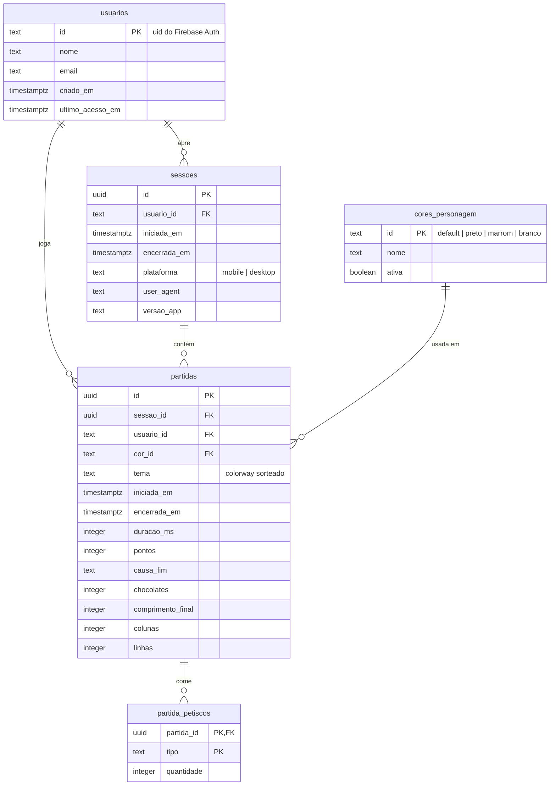

# Modelagem do banco de dados — Osvaldo Games

> **Status:** proposta para discussão. Nada daqui está implementado ainda.

## 1. Onde guardar: Firebase Data Connect (PostgreSQL)

O requisito é ter dados **relacionais**, para tirar métricas de uso depois.
Dentro do Firebase há duas opções:

| Opção | Relacional? | Métricas | Observação |
| --- | --- | --- | --- |
| **Firebase Data Connect** | Sim — é um **PostgreSQL** (Cloud SQL) | SQL direto: `JOIN`, `GROUP BY`, views | O app fala com o banco por GraphQL gerado pelo Firebase; o Firebase Auth que já existe controla quem lê/escreve o quê. |
| Cloud Firestore | Não (documentos) | Exige exportar para o BigQuery | Agregações como "recorde de cada jogador" ou "ranking geral" precisam ser mantidas à mão (contadores duplicados). |

**Recomendação: Data Connect.** Ele atende o "relacional" de verdade, usa o
mesmo projeto `osvaldo-games` e o mesmo login, e qualquer métrica futura vira
uma consulta SQL — sem migrar de banco depois.

Custo: o Data Connect usa uma instância do Cloud SQL e exige o plano **Blaze**
(pago por uso) no projeto Firebase. Isso precisa ser confirmado antes de
implementar.

## 2. Da lista inicial para tabelas

Dos sete itens levantados, só alguns são entidades (tabelas). Os outros são
**atributos** de uma entidade ou **resultados de consulta**. Guardar um valor
calculado numa tabela própria cria duas fontes da verdade que podem divergir
(ex.: a tabela "recorde" dizendo 12 e as partidas mostrando 15).

| Item pedido | Onde fica | Por quê |
| --- | --- | --- |
| Usuários | Tabela `usuarios` | Entidade. O `id` é o `uid` do Firebase Auth. |
| Cor do personagem | Tabela `cores_personagem` + coluna `partidas.cor_id` | Catálogo das cores (`default`, `preto`, `marrom`, `branco`). A cor é escolhida **a cada partida**, então é ali que ela é registrada — é o que permite medir "qual cor é mais escolhida". |
| Última sessão | Tabela `sessoes` (+ coluna `usuarios.ultimo_acesso_em`) | Cada abertura do app vira uma linha, guardando o histórico inteiro, não só a última. "Última sessão" = a mais recente. |
| Tempo de jogada | Coluna `partidas.duracao_ms` | Atributo da partida. Tempo total do jogador = soma. |
| Total de pontos da partida | Coluna `partidas.pontos` | Atributo da partida. |
| Recorde | **View** `vw_recordes` | É o `MAX(pontos)` das partidas de cada usuário. |
| Usuário com mais pontos | **View** `vw_ranking` | Ordenação de `vw_recordes`. |

Foram acrescentadas as colunas que o jogo já produz e que serão úteis para
métricas: causa do fim de jogo, chocolates comidos, petiscos comidos, tema de
cores sorteado, tamanho do tabuleiro e plataforma (celular ou computador).

## 3. Diagrama



## 4. Tabelas

### `usuarios`

| Coluna | Tipo | Regra |
| --- | --- | --- |
| `id` | `text` PK | `uid` do Firebase Auth — sem id próprio, para não ter dois identificadores do mesmo jogador. |
| `nome` | `text` not null | Nome exibido no placar. |
| `email` | `text` not null, único | Cópia do Auth, para relatórios. |
| `criado_em` | `timestamptz` not null | Data do cadastro. |
| `ultimo_acesso_em` | `timestamptz` | Atualizada ao abrir uma sessão. É uma cópia de conveniência de `MAX(sessoes.iniciada_em)`, para a listagem de usuários não precisar varrer as sessões. |

### `cores_personagem`

Catálogo fixo, espelhando `FurColorId` de `src/game/draw.ts`. Ter a tabela (em
vez de só um texto solto na partida) garante que nenhuma partida aponte para
uma cor inexistente e permite desativar uma cor sem apagar o histórico.

| Coluna | Tipo | Regra |
| --- | --- | --- |
| `id` | `text` PK | `default`, `preto`, `marrom`, `branco` |
| `nome` | `text` not null | Rótulo exibido. |
| `ativa` | `boolean` not null, padrão `true` | Cor ainda aparece na escolha. |

### `sessoes`

Uma sessão começa quando o jogador entra (login, cadastro ou sessão salva ao
reabrir o app) e termina ao sair da conta ou fechar a aba.

| Coluna | Tipo | Regra |
| --- | --- | --- |
| `id` | `uuid` PK | |
| `usuario_id` | `text` FK → `usuarios` | not null |
| `iniciada_em` | `timestamptz` not null | |
| `encerrada_em` | `timestamptz` | Nulo se a aba foi fechada sem aviso. |
| `plataforma` | `text` | `mobile` ou `desktop` (toque × teclado). |
| `user_agent` | `text` | Navegador/aparelho, para métricas de dispositivo. |
| `versao_app` | `text` | Versão do build, para comparar antes/depois de uma mudança de balanceamento. |

### `partidas`

Uma linha por partida terminada. É a tabela central das métricas.

| Coluna | Tipo | Regra |
| --- | --- | --- |
| `id` | `uuid` PK | |
| `sessao_id` | `uuid` FK → `sessoes` | not null |
| `usuario_id` | `text` FK → `usuarios` | not null. Repetido da sessão de propósito: quase toda consulta filtra por jogador. |
| `cor_id` | `text` FK → `cores_personagem` | not null |
| `tema` | `text` | Colorway sorteado (`magenta`, `lime`…). |
| `iniciada_em` | `timestamptz` not null | Fim da contagem regressiva. |
| `encerrada_em` | `timestamptz` not null | |
| `duracao_ms` | `integer` not null, ≥ 0 | **Tempo de jogada**, sem contar pausas. |
| `pontos` | `integer` not null, ≥ 0 | **Total de pontos da partida.** |
| `causa_fim` | `text` not null | `tail`, `wall`, `bomb`, `chocolate` (o `DeathCause` do jogo) ou `abandono` (saiu pela pausa). |
| `chocolates` | `integer` not null, padrão 0 | |
| `comprimento_final` | `integer` | Tamanho do Osvaldo no fim. |
| `colunas`, `linhas` | `integer` | Tabuleiro da partida (varia com a tela). |

### `partida_petiscos`

Quantos petiscos de cada tipo foram comidos na partida (`bone`, `beef`,
`strawberry`, `banana`, `avocado`, `watermelon`, `chocolate`, `bomb`). Fica
numa tabela à parte em vez de seis colunas em `partidas` para que um petisco
novo não exija alterar a estrutura.

| Coluna | Tipo | Regra |
| --- | --- | --- |
| `partida_id` | `uuid` FK → `partidas` | PK composta |
| `tipo` | `text` | PK composta |
| `quantidade` | `integer` not null, > 0 | |

## 5. SQL de referência (PostgreSQL)

No Data Connect as tabelas são declaradas em GraphQL (`schema.gql`) e o
Firebase gera o SQL; o script abaixo mostra o resultado esperado e serve de
referência para as consultas.

```sql
create table usuarios (
  id               text primary key,
  nome             text not null,
  email            text not null unique,
  criado_em        timestamptz not null default now(),
  ultimo_acesso_em timestamptz
);

create table cores_personagem (
  id    text primary key,
  nome  text not null,
  ativa boolean not null default true
);

insert into cores_personagem (id, nome) values
  ('default', 'Arlequim'), ('preto', 'Preto'), ('marrom', 'Marrom'), ('branco', 'Branco');

create table sessoes (
  id           uuid primary key default gen_random_uuid(),
  usuario_id   text not null references usuarios(id),
  iniciada_em  timestamptz not null default now(),
  encerrada_em timestamptz,
  plataforma   text check (plataforma in ('mobile', 'desktop')),
  user_agent   text,
  versao_app   text
);

create table partidas (
  id                uuid primary key default gen_random_uuid(),
  sessao_id         uuid not null references sessoes(id),
  usuario_id        text not null references usuarios(id),
  cor_id            text not null references cores_personagem(id),
  tema              text,
  iniciada_em       timestamptz not null,
  encerrada_em      timestamptz not null,
  duracao_ms        integer not null check (duracao_ms >= 0),
  pontos            integer not null check (pontos >= 0),
  causa_fim         text not null check (causa_fim in ('tail', 'wall', 'bomb', 'chocolate', 'abandono')),
  chocolates        integer not null default 0,
  comprimento_final integer,
  colunas           integer,
  linhas            integer
);

create table partida_petiscos (
  partida_id uuid not null references partidas(id) on delete cascade,
  tipo       text not null,
  quantidade integer not null check (quantidade > 0),
  primary key (partida_id, tipo)
);

-- Recorde e ranking saem destes índices sem varrer a tabela.
create index partidas_usuario_pontos on partidas (usuario_id, pontos desc);
create index partidas_encerrada_em   on partidas (encerrada_em);
create index sessoes_usuario_inicio  on sessoes  (usuario_id, iniciada_em desc);

-- Recorde de cada jogador (a primeira partida que alcançou o maior placar).
create view vw_recordes as
select distinct on (p.usuario_id)
       p.usuario_id, u.nome, p.pontos as recorde, p.id as partida_id, p.encerrada_em as alcancado_em
  from partidas p
  join usuarios u on u.id = p.usuario_id
 order by p.usuario_id, p.pontos desc, p.encerrada_em asc;

-- Ranking geral: a primeira linha é o usuário que mais fez pontos.
-- Empate: fica à frente quem chegou primeiro ao placar.
create view vw_ranking as
select rank() over (order by recorde desc, alcancado_em asc) as posicao, *
  from vw_recordes;
```

## 6. Exemplos de métricas

```sql
-- Última sessão de cada usuário
select u.nome, max(s.iniciada_em) as ultima_sessao
  from usuarios u left join sessoes s on s.usuario_id = u.id
 group by u.id, u.nome;

-- Tempo total jogado e média de pontos por jogador
select usuario_id, sum(duracao_ms) / 60000.0 as minutos_jogados,
       count(*) as partidas, avg(pontos) as media_pontos
  from partidas group by usuario_id;

-- Cor mais escolhida
select cor_id, count(*) from partidas group by cor_id order by 2 desc;

-- Como as partidas terminam (o chocolate está difícil demais?)
select causa_fim, count(*), avg(pontos) from partidas group by causa_fim;

-- Jogadores ativos por dia e partidas por sessão
select date_trunc('day', iniciada_em) as dia, count(distinct usuario_id) as ativos
  from sessoes group by 1 order by 1;
select avg(qtd) from (select count(*) as qtd from partidas group by sessao_id) t;

-- Celular × computador
select s.plataforma, count(p.id) as partidas, avg(p.duracao_ms) / 1000 as segundos
  from partidas p join sessoes s on s.id = p.sessao_id group by s.plataforma;
```

## 7. Segurança

- Cada operação do Data Connect declara `@auth`: o jogador só cria sessões e
  partidas com o próprio `uid` e só lê os próprios dados. O ranking é exposto
  por uma consulta pública que devolve apenas `posicao`, `nome` e `recorde`
  (nunca o e-mail).
- **Limite conhecido:** os pontos são calculados no navegador, então um
  jogador com conhecimento técnico consegue enviar um placar falso. Para um
  ranking casual isso é aceitável; se o ranking virar competição com prêmio,
  a validação precisa ir para o servidor (ex.: Cloud Function que confere
  `pontos` × `duracao_ms` × petiscos comidos).

## 8. Decisões em aberto

1. **Plano Blaze** liberado no projeto `osvaldo-games`? (pré-requisito do Data Connect)
2. **Recorde da tela de fim de jogo:** hoje é o melhor *da sessão*. Com o
   banco, passa a ser o recorde de todas as partidas do jogador, ou continua
   o da sessão (e o histórico fica só nas métricas)?
3. **Partidas abandonadas** (sair pela pausa) devem ser gravadas? A proposta
   grava com `causa_fim = 'abandono'`, mas elas não contam para o recorde se
   decidirmos assim.
4. **Cor preferida:** vale lembrar a última cor escolhida do jogador
   (`usuarios.cor_preferida_id`), ou a escolha continua sempre começando no
   padrão?
5. **Sem internet:** se a partida terminar offline, guardamos localmente e
   enviamos depois, ou descartamos?
